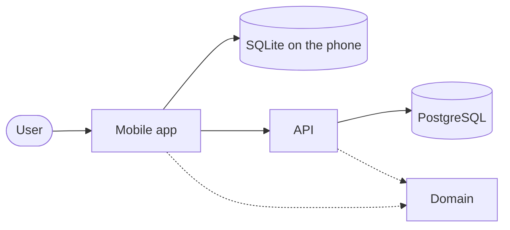

# Architecture

The system as it is now, on one page. Reasons live in `docs/adr/`.

| Part | Responsibility | Where |
|---|---|---|
| Mobile app | What a member does on the phone, including offline; syncs with the API | `apps/mobile` |
| API | Authorizes members and devices, and stores and exchanges each shared ledger's sync events; applies no bookkeeping rules. Serves what lets an invite link open the app, and the page for a phone without it | `apps/api` |
| Domain | Rules every client applies identically, and the API's request and response types with the functions that check them | `packages/domain` |

Name top-level directories only. File paths go stale.

## Principles

- Each capability's code lives in one directory per app, named after its spec (ADR-0002).
- A rule every client applies lives once, in `packages/domain`; no client redefines it (ADR-0002).
- The API only authorizes members and devices and exchanges sync events; it never applies bookkeeping rules, and each client checks the events it receives (ADR-0003).
- The API stores data only in PostgreSQL, in tests too (ADR-0002).
- The API's code runs unchanged on Node and on Cloudflare Workers; only one entry file per runtime knows which (ADR-0007).
- The API runs in a staging and a production environment, each with its own Worker, Hyperdrive configuration, and database; a deploy runs the migrations before it uploads the Worker, and no request runs them (ADR-0019).
- The API checks every request's signature before routing, unless the route is public; a refused request changes nothing in its database (ADR-0022).
- The phone sends every request to the API through one function, which signs it with the phone's own key (ADR-0015, ADR-0022).
- A phone creates a shared ledger's group on the API under the group's own ID. The API stores each event once, numbers a group's events in the order it stores them, hands them out in small pages by cursor, and refuses an upload that would take a group's events past 10 MiB (ADR-0016, ADR-0024).
- On the phone, data lives in SQLite; zustand holds only screen state (ADR-0002).
- The phone keeps all its data in one SQLite database; every capability's migrations run in one app-wide order and never change once a release tag contains them (ADR-0006).
- Only `apps/mobile/src/storage/` imports `expo-sqlite`; tests run the same migrations and queries on SQLite in Node (ADR-0006).
- An export file is a copy of the phone's database, with no secrets in it; import checks a file as untrusted input, then replaces the phone's data in one transaction (ADR-0020). A shared ledger's sync state goes back to the export with it, except the latest stamp the phone has seen (ADR-0025).
- Only `apps/mobile/src/storage/` reaches the phone's files, share sheet, and file picker; tests put Node's file system and a share sheet and picker of their own in their place (ADR-0020).
- Recording and changing data never needs the network, except changing which phones can open a shared ledger (ADR-0015); sync runs separately and never blocks a local save (ADR-0005).
- The app contacts no server until the phone first creates or joins a shared ledger (ADR-0015).
- Ledger content reaches the server only end-to-end encrypted; the API never holds a key that opens it (ADR-0015).
- Every phone merges sync events with pure functions in `packages/domain` and reaches the same result, whatever order the events arrive in (ADR-0016).
- An invite link points at the API's own address. The API serves the files that let it open the app and one static page for a phone without the app; the page loads nothing from elsewhere and sends what follows the link's `#` to no server (ADR-0023).
- Only `apps/mobile/src/ui/` knows which platform it runs on (ADR-0002).
- Money is an integer in its currency's minor unit, paired with its currency code; each currency's decimal places come from a fixed table in `packages/domain`, never from the device (ADR-0004).
