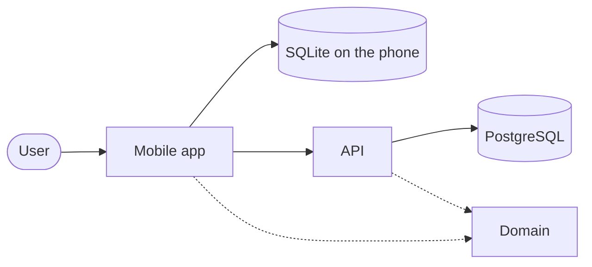

# Architecture

The system as it is now, on one page. Reasons live in `docs/adr/`.

| Part | Responsibility | Where |
|---|---|---|
| Mobile app | What a member does on the phone, including offline; syncs with the API | `apps/mobile` |
| API | Authorizes members and devices, and stores and exchanges each shared ledger's sync events; applies no bookkeeping rules | `apps/api` |
| Domain | Rules every client applies identically, and the API's request and response types | `packages/domain` |

Name top-level directories only. File paths go stale.

## Principles

- Each capability's code lives in one directory per app, named after its spec (ADR-0002).
- A rule every client applies lives once, in `packages/domain`; no client redefines it (ADR-0002).
- The API only authorizes members and devices and exchanges sync events; it never applies bookkeeping rules, and each client checks the events it receives (ADR-0003).
- The API stores data only in PostgreSQL, in tests too (ADR-0002).
- On the phone, data lives in SQLite; zustand holds only screen state (ADR-0002).
- The phone keeps all its data in one SQLite database; every capability's migrations run in one app-wide order (ADR-0006).
- Only `apps/mobile/src/storage/` imports `expo-sqlite`; tests run the same migrations and queries on SQLite in Node (ADR-0006).
- Recording and changing data never needs the network; sync runs separately and never blocks a local save (ADR-0005).
- Only `apps/mobile/src/ui/` knows which platform it runs on (ADR-0002).
- Money is an integer in its currency's minor unit, paired with its currency code; each currency's decimal places come from a fixed table in `packages/domain`, never from the device (ADR-0004).
